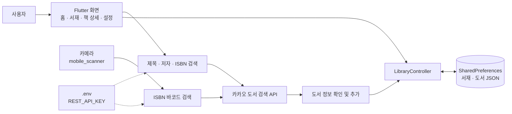

<div align="center">

# HomeLibrary

[English](README.md) | **한국어**

**내가 가진 책과 독서 기록을 한곳에서 관리하는 나만의 모바일 서재**

서재별 도서 관리 · ISBN 바코드 스캔 · 카카오 도서 검색 · 읽기 상태와 평점 · 한줄평


[주요 기능](#주요-기능) · [아키텍처](#아키텍처) · [빠른 시작](#빠른-시작) · [사용 방법](#사용-방법) · [빌드와 릴리스](#빌드와-릴리스) · [개발](#개발)

</div>

## 한눈에 보기

| 기능 | 설명 |
|---|---|
| **공간별 서재** | 서재 이름과 위치를 지정하고, 서재마다 책을 나누어 보관합니다. |
| **검색으로 책 추가** | 제목·저자·ISBN으로 카카오 도서 검색 결과를 조회하고 서재에 추가합니다. |
| **바코드로 책 추가** | 카메라로 ISBN 바코드를 스캔해 도서 정보를 불러옵니다. 같은 서재의 ISBN 중복도 확인합니다. |
| **독서 기록** | 읽기 상태, 별점 1~5점, 한줄평을 책마다 기록합니다. |
| **홈 대시보드** | 전체 도서 수, 읽기 상태별 수량, 최근 추가한 책 5권, 서재별 현황을 확인합니다. |
| **두 가지 책 보기** | 표지 중심의 격자 보기와 정보 중심의 목록 보기를 전환합니다. |
| **기기 내 저장** | 서재와 독서 기록을 SharedPreferences에 저장합니다. 별도 계정이나 자체 백엔드는 없습니다. |
| **시스템 테마 연동** | Material 3 기반으로 기기의 라이트·다크 모드를 따릅니다. |

## 주요 기능

### 서재와 도서 관리

- 서재를 만들 때 **이름과 위치**를 입력합니다.
- 서재 정보를 수정하거나 서재를 삭제할 수 있습니다.
- 서재 목록은 이름순, 서재 안의 책은 제목순으로 표시합니다.
- 도서 검색 결과의 표지, 저자, 출판사, ISBN, 책 소개와 상세 페이지 주소를 저장합니다.
- 책 상세 화면에서 정보를 확인하고, **자세히 보기**로 외부 상세 페이지를 열거나 책을 삭제합니다.

### 도서 등록

| 방법 | 흐름 |
|---|---|
| 검색해서 추가 | 검색어 입력 → 카카오 도서 검색 → 결과 선택 → 정보 확인 → 서재에 추가 |
| 바코드로 추가 | 카메라 권한 허용 → ISBN 스캔 → 카카오 ISBN 검색 → 중복 확인 → 정보 확인 후 추가 |

검색과 바코드 조회에는 인터넷 연결과 **카카오 REST API 키**가 필요합니다. 저장된 서재와 독서 기록은 기기에서 불러오며, 표지 이미지는 네트워크로 가져옵니다.

### 독서 기록

| 항목 | 지원 내용 |
|---|---|
| 읽기 상태 | 읽고 싶은 · 읽고 있는 · 다 읽은 · 중단한 |
| 평점 | 별점 1~5점. 선택한 별을 다시 누르면 평점을 해제합니다. |
| 한줄평 | 책에 대한 짧은 메모. 입력 완료 또는 입력창 바깥을 누르면 저장합니다. |
| 홈 통계 | 읽기 상태별 도서 수와 서재별 보유 도서 수를 집계합니다. |

## 아키텍처

Flutter 앱이 카카오 도서 검색 API에 직접 요청하고, 사용자가 추가한 책과 독서 기록은 기기 내에 저장합니다.



### 구성 요소

| 구성 요소 | 역할 | 기술 |
|---|---|---|
| `lib/main.dart` | 환경 변수 로드, 테마, 하단 탭 내비게이션 | Flutter, Material 3, flutter_dotenv |
| `lib/screen/` | 대시보드, 서재, 도서 검색·스캔, 상세 기록, 설정 | Flutter Widgets |
| `lib/model/Library.dart` | 서재·도서 모델, 읽기 상태, JSON 직렬화 | Dart |
| `lib/controller/controller.dart` | 서재와 도서의 저장·조회·수정·삭제 | shared_preferences |
| 도서 검색 | 검색어 및 ISBN으로 도서 정보 조회 | Kakao API, http |
| 바코드 스캔 | 카메라로 바코드 인식 | mobile_scanner |
| 외부 상세 페이지 | 도서 상세 URL 열기 | url_launcher |

## 빠른 시작

### 준비 사항

- [Flutter SDK](https://docs.flutter.dev/install): 포함된 Dart SDK가 `^3.10.7` 조건을 만족하는 버전
- Android 개발: Android SDK, JDK 17, 에뮬레이터 또는 실제 기기
- iOS 개발: macOS, Xcode, CocoaPods, 시뮬레이터 또는 실제 기기
- [Kakao Developers](https://developers.kakao.com/)에서 발급한 REST API 키

먼저 `flutter doctor`로 대상 플랫폼의 개발 환경을 확인하세요.

### 설치와 실행

```bash
git clone https://github.com/kimrasng/HomeLibrary.git
cd HomeLibrary
cp .env.example .env
```

프로젝트 루트의 `.env`를 열고 REST API 키를 입력합니다.

```dotenv
REST_API_KEY=your_kakao_rest_api_key_here
```

```bash
flutter pub get
flutter devices
flutter run
```

기기가 여러 대 연결되어 있다면 `flutter run -d <DEVICE_ID>`로 실행 대상을 지정합니다.

> [!NOTE]
> 앱은 시작할 때 `.env`를 읽으므로 실행 전에 파일을 만들어야 합니다. 카카오 **REST API 키**를 사용하며, JavaScript 키나 네이티브 앱 키를 넣지 않습니다. `.env`는 Git에서 제외되어 있습니다.

## 사용 방법

1. **서재** 탭에서 오른쪽 위 `+`를 눌러 서재 이름과 위치를 입력합니다.
2. 만든 서재를 열고 `+`에서 **검색해서 추가** 또는 **바코드로 추가**를 선택합니다.
3. 검색하거나 스캔한 책의 정보를 확인하고 **추가**를 누릅니다.
4. 책을 눌러 상세 화면에서 읽기 상태, 평점, 한줄평을 기록합니다.
5. **홈**에서 독서 현황을 확인합니다. 기록이 바로 반영되지 않으면 화면을 아래로 당겨 새로고침합니다.

<details>
<summary><b>데이터 저장과 현재 지원 범위</b></summary>

- 서재와 도서는 SharedPreferences의 `libraries` 키에 JSON으로 저장됩니다.
- 앱 내 클라우드 동기화, 계정 로그인, 백업·복원 기능은 구현되어 있지 않습니다.
- **검색해서 추가**는 검색 API 결과에서 책을 고르는 기능입니다. 도서 정보를 직접 작성하는 입력 폼은 없습니다.
- 설정에 **바코드 자동 추가** 스위치가 있으나, 현재 스캔 흐름은 해당 설정을 읽지 않아 확인 후 추가 방식으로 동작합니다.
- Android와 iOS 프로젝트가 포함되어 있으며, 자동 릴리스 워크플로는 Android APK를 대상으로 합니다.

</details>

## 빌드와 릴리스

### Android APK

`.env` 설정과 의존성 설치를 마친 후 실행합니다.

```bash
flutter build apk --release
```

결과 파일은 `build/app/outputs/flutter-apk/app-release.apk`입니다.

로컬에서 `android/key.properties`가 있으면 해당 릴리스 서명 설정을 사용하고, 없으면 디버그 키로 서명합니다. 배포용 서명 설정은 `android/app/build.gradle.kts`에서 확인할 수 있습니다.

### GitHub Actions

[Build & Release APK](.github/workflows/build-release.yml) 워크플로는 `v*.*` 패턴의 태그가 푸시되면 실행됩니다. 현재 버전 파싱에 맞춰 `v1.0`처럼 **두 자리 버전 태그**를 사용합니다.

| 단계 | 내용 |
|---|---|
| 환경 준비 | Java 17과 Flutter stable 설치 |
| 설정 복원 | GitHub Secrets에서 `.env`, 키스토어, 서명 속성 생성 |
| 빌드 | `flutter pub get` 후 릴리스 APK 빌드 |
| 배포 | GitHub Release를 생성하고 `app-release.apk` 첨부 |

저장소의 Actions Secrets에 다음 값을 설정해야 합니다.

| Secret | 내용 |
|---|---|
| `ENV_FILE` | `REST_API_KEY=...`를 포함한 `.env` 전체 내용 |
| `KEYSTORE_BASE64` | 릴리스 키스토어 파일을 Base64로 인코딩한 값 |
| `KEYSTORE_PASSWORD` | 키스토어 비밀번호 |
| `KEY_PASSWORD` | 서명 키 비밀번호 |
| `KEY_ALIAS` | 서명 키 별칭 |

## 개발

```text
HomeLibrary/
├── lib/
│   ├── main.dart                 앱 진입점, 테마, 탭 내비게이션
│   ├── controller/
│   │   └── controller.dart       서재·도서 CRUD와 로컬 저장
│   ├── model/
│   │   └── Library.dart          서재·도서 모델과 읽기 상태
│   └── screen/
│       ├── Home.dart             독서 대시보드
│       ├── Library.dart          서재 목록
│       ├── book.dart             서재 내 도서 목록
│       ├── book_detail.dart      도서 상세와 독서 기록
│       ├── addmanually.dart      카카오 도서 검색
│       ├── barcode.dart          ISBN 바코드 스캔
│       ├── Settings.dart         앱 설정
│       └── component/            서재 추가·편집 UI
├── android/                      Android 프로젝트와 서명 설정
├── ios/                          iOS 프로젝트
├── .github/workflows/            APK 빌드·릴리스 자동화
├── .env.example                  환경 변수 예시
└── pubspec.yaml                  패키지와 에셋 설정
```

```bash
flutter pub get       # 의존성 설치
flutter analyze       # 정적 분석
flutter run           # 개발 실행
```

현재 저장소에는 Dart/Flutter 테스트 파일이 없습니다.

## 문제 해결

<details>
<summary><b>시작할 때 .env 파일을 찾지 못해요</b></summary>

프로젝트 루트에서 `.env.example`을 `.env`로 복사했는지 확인하세요. `pubspec.yaml`에 `.env`가 에셋으로 등록되어 있으며, `lib/main.dart`에서 앱 실행 전에 로드합니다.

</details>

<details>
<summary><b>책 검색이나 ISBN 조회에 실패해요</b></summary>

인터넷 연결과 `.env`의 `REST_API_KEY` 값을 확인하세요. 요청은 `Authorization: KakaoAK ...` 헤더로 카카오 도서 검색 API에 전송됩니다. 키를 변경했다면 앱을 완전히 다시 실행하세요.

Android 릴리스 빌드에서만 통신이 실패한다면 `android/app/src/main/AndroidManifest.xml`의 `android.permission.INTERNET` 선언을 확인하세요. 현재 저장소에는 해당 권한이 debug/profile 매니페스트에만 선언되어 있습니다.

</details>

<details>
<summary><b>바코드를 스캔할 수 없어요</b></summary>

기기 설정에서 앱의 카메라 접근 권한을 확인하고, 실제 책의 ISBN 바코드를 스캔하세요. 인식한 ISBN의 도서 정보를 조회하려면 인터넷 연결도 필요합니다.

</details>

<details>
<summary><b>책을 추가했는데 홈의 수량이 바뀌지 않아요</b></summary>

홈 화면을 아래로 당겨 새로고침하세요. 저장된 서재를 다시 읽어 도서 수와 읽기 상태별 통계를 계산합니다.

</details>
