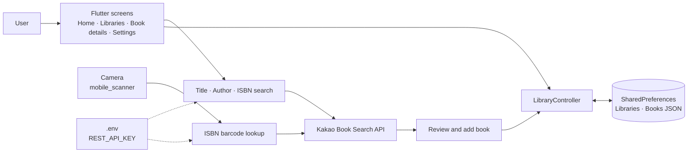

<div align="center">

# HomeLibrary

**Your personal mobile library for managing books and reading records in one place**

Organize books by library · Scan ISBN barcodes · Search with Kakao Books · Track reading status and ratings · Write short reviews


**English** | [한국어](README.ko.md)

[Features](#features) · [Architecture](#architecture) · [Quick Start](#quick-start) · [Usage](#usage) · [Build and Release](#build-and-release) · [Development](#development)

</div>

## At a Glance

| Feature | Description |
|---|---|
| **Libraries by location** | Give each library a name and location, and organize your books into separate libraries. |
| **Add books by search** | Search Kakao Books by title, author, or ISBN and add results to a library. |
| **Add books by barcode** | Scan an ISBN barcode with your camera to look up book details. Check for duplicate ISBNs in the same library. |
| **Reading records** | Record reading status, a 1–5 star rating, and a short review for each book. |
| **Home dashboard** | View total book counts, counts by reading status, the five most recently added books, and a summary of each library. |
| **Two book views** | Switch between a cover-focused grid and an information-focused list. |
| **On-device storage** | Libraries and reading records are stored in SharedPreferences. No account or dedicated backend is required. |
| **System theme** | The Material 3 interface follows your device's light or dark mode. |

## Features

### Library and Book Management

- Enter a **name and location** when creating a library.
- Edit library details or delete a library.
- Libraries are sorted by name, and books within a library are sorted by title.
- Save the cover, author, publisher, ISBN, description, and detail page URL from book search results.
- View book information on the detail screen, open the external detail page with **View details**, or delete the book.

### Adding Books

| Method | Flow |
|---|---|
| Add by search | Enter a query → Search Kakao Books → Select a result → Review details → Add to a library |
| Add by barcode | Allow camera access → Scan an ISBN → Search Kakao by ISBN → Check for duplicates → Review details and add |

Search and barcode lookups require an internet connection and a **Kakao REST API key**. Saved libraries and reading records are loaded from your device, while cover images are fetched over the network.

### Reading Records

| Field | Supported behavior |
|---|---|
| Reading status | Want to read · Reading · Finished · Abandoned |
| Rating | 1–5 stars. Tap the selected star again to clear the rating. |
| Short review | A brief note about the book. Saved when you finish editing or tap outside the input field. |
| Home statistics | Book counts by reading status and the number of books in each library. |

## Architecture

The Flutter app calls the Kakao Book Search API directly. Books added by the user and their reading records are stored on the device.



### Components

| Component | Responsibility | Technology |
|---|---|---|
| `lib/main.dart` | Environment loading, theme, and bottom tab navigation | Flutter, Material 3, flutter_dotenv |
| `lib/screen/` | Dashboard, libraries, book search and scanning, reading details, and settings | Flutter Widgets |
| `lib/model/Library.dart` | Library and book models, reading status, and JSON serialization | Dart |
| `lib/controller/controller.dart` | Create, read, update, and delete libraries and books | shared_preferences |
| Book search | Look up book information by query or ISBN | Kakao API, http |
| Barcode scanning | Recognize barcodes with the camera | mobile_scanner |
| External detail pages | Open book detail URLs | url_launcher |

## Quick Start

### Prerequisites

- [Flutter SDK](https://docs.flutter.dev/install) with a bundled Dart SDK that satisfies `^3.10.7`
- Android development: Android SDK, JDK 17, and an emulator or physical device
- iOS development: macOS, Xcode, CocoaPods, and a simulator or physical device
- A REST API key issued through [Kakao Developers](https://developers.kakao.com/)

Run `flutter doctor` first to check the development environment for your target platform.

### Install and Run

```bash
git clone https://github.com/kimrasng/HomeLibrary.git
cd HomeLibrary
cp .env.example .env
```

Open `.env` in the project root and enter your REST API key.

```dotenv
REST_API_KEY=your_kakao_rest_api_key_here
```

```bash
flutter pub get
flutter devices
flutter run
```

If multiple devices are connected, select one with `flutter run -d <DEVICE_ID>`.

> [!NOTE]
> The app loads `.env` at startup, so create the file before running it. Use a Kakao **REST API key**, not a JavaScript key or native app key. `.env` is excluded from Git.

## Usage

The steps below use English translations of the app's Korean interface labels.

1. In the **Libraries** tab, tap `+` in the upper-right corner and enter a library name and location.
2. Open the library, tap `+`, and choose **Add by search** or **Add by barcode**.
3. Review the details of the book you found or scanned, then tap **Add**.
4. Tap a book to record its reading status, rating, and short review on the detail screen.
5. Check your reading overview on **Home**. Pull down to refresh if your records are not reflected immediately.

<details>
<summary><b>Data storage and current scope</b></summary>

- Libraries and books are stored as JSON under the `libraries` key in SharedPreferences.
- In-app cloud sync, account login, and backup or restore are not implemented.
- **Add by search** lets you choose a book from search API results. There is no form for entering book details manually.
- Settings includes an **Automatically add scanned books** switch, but the current scan flow does not read this setting and still requires confirmation before adding a book.
- Android and iOS projects are included. The automated release workflow targets Android APKs.

</details>

## Build and Release

### Android APK

After configuring `.env` and installing dependencies, run:

```bash
flutter build apk --release
```

The output file is `build/app/outputs/flutter-apk/app-release.apk`.

Local builds use the release signing configuration in `android/key.properties` if the file exists; otherwise, they are signed with the debug key. See `android/app/build.gradle.kts` for the distribution signing configuration.

### GitHub Actions

The [Build & Release APK](.github/workflows/build-release.yml) workflow runs when a tag matching `v*.*` is pushed. Use a **two-component version tag**, such as `v1.0`, to match the current version parser.

| Stage | Description |
|---|---|
| Environment setup | Install Java 17 and Flutter stable |
| Configuration restore | Create `.env`, the keystore, and signing properties from GitHub Secrets |
| Build | Run `flutter pub get` and build a release APK |
| Publish | Create a GitHub Release and attach `app-release.apk` |

Configure the following Actions Secrets in the repository:

| Secret | Description |
|---|---|
| `ENV_FILE` | The full contents of `.env`, including `REST_API_KEY=...` |
| `KEYSTORE_BASE64` | The release keystore file encoded as Base64 |
| `KEYSTORE_PASSWORD` | Keystore password |
| `KEY_PASSWORD` | Signing key password |
| `KEY_ALIAS` | Signing key alias |

## Development

```text
HomeLibrary/
├── lib/
│   ├── main.dart                 App entry point, theme, and tab navigation
│   ├── controller/
│   │   └── controller.dart       Library and book CRUD and local storage
│   ├── model/
│   │   └── Library.dart          Library and book models and reading status
│   └── screen/
│       ├── Home.dart             Reading dashboard
│       ├── Library.dart          Library list
│       ├── book.dart             Books in a library
│       ├── book_detail.dart      Book details and reading records
│       ├── addmanually.dart      Kakao book search
│       ├── barcode.dart          ISBN barcode scanning
│       ├── Settings.dart         App settings
│       └── component/            Library creation and editing UI
├── android/                      Android project and signing configuration
├── ios/                          iOS project
├── .github/workflows/            APK build and release automation
├── .env.example                  Example environment variables
└── pubspec.yaml                  Package and asset configuration
```

```bash
flutter pub get       # Install dependencies
flutter analyze       # Run static analysis
flutter run           # Run for development
```

The repository currently has no Dart or Flutter test files.

## Troubleshooting

<details>
<summary><b>The .env file cannot be found at startup</b></summary>

Make sure you copied `.env.example` to `.env` in the project root. `.env` is registered as an asset in `pubspec.yaml` and loaded in `lib/main.dart` before the app starts.

</details>

<details>
<summary><b>Book search or ISBN lookup fails</b></summary>

Check your internet connection and the `REST_API_KEY` value in `.env`. Requests are sent to the Kakao Book Search API with the `Authorization: KakaoAK ...` header. Restart the app completely after changing the key.

If networking fails only in Android release builds, check the `android.permission.INTERNET` declaration in `android/app/src/main/AndroidManifest.xml`. In the current repository, this permission is declared only in the debug and profile manifests.

</details>

<details>
<summary><b>Barcode scanning does not work</b></summary>

Check the app's camera permission in your device settings and scan the ISBN barcode on a physical book. An internet connection is also required to look up book details for the scanned ISBN.

</details>

<details>
<summary><b>The Home count does not change after adding a book</b></summary>

Pull down on the Home screen to refresh. The app reloads saved libraries and recalculates book counts and reading status statistics.

</details>
